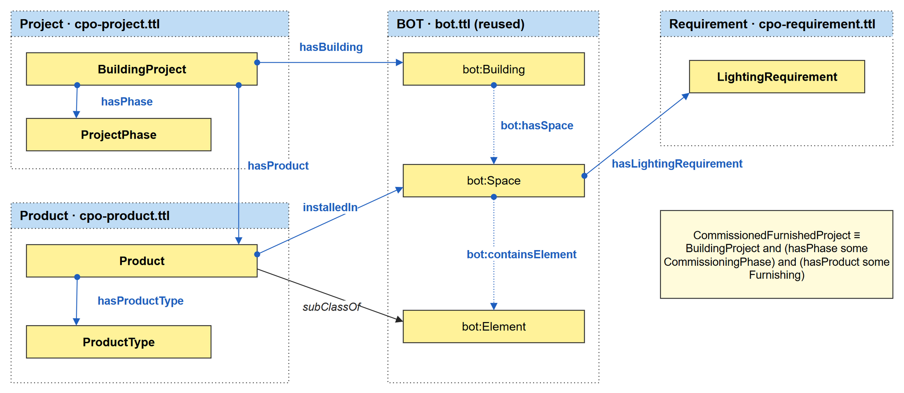
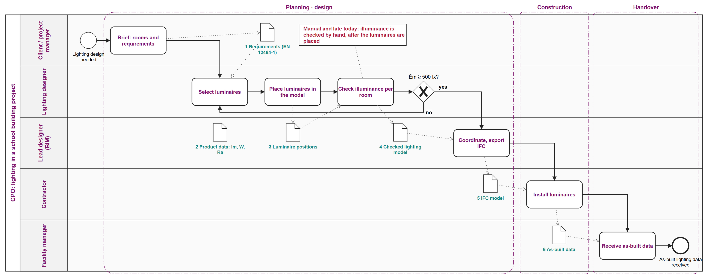
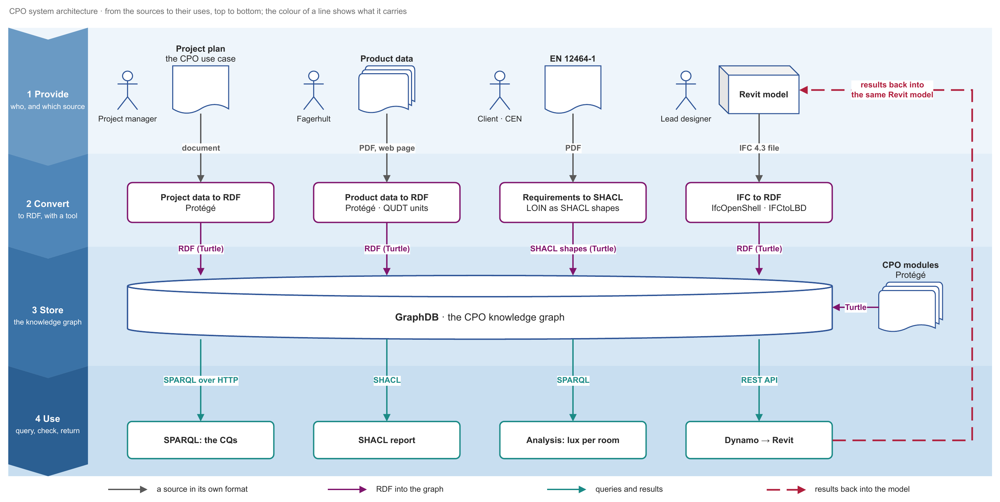

# Construction Project Typology Ontology (CPO)

An OWL ontology of building projects, their phases, the products installed in their buildings, and the requirements on their spaces. It is the worked example of the course TADS23 Advanced Building Information Delivery at Jönköping University.

*The composed ontology in Graffoo (Lecture 4c, step 8): yellow boxes are classes, blue arrows object properties, and dotted boxes modules. The spanning axioms `hasBuilding`, `installedIn` and `hasLightingRequirement` connect the modules with BOT.*

- Website: https://richzele.github.io/cpo/, with the modules, the merged ontology, the data, their documentation and every file
- Ontology: https://w3id.org/cpo
- Documentation: https://richzele.github.io/cpo/doc/cpo/, made with [WIDOCO](https://github.com/dgarijo/Widoco), with a WebVOWL diagram of each ontology
- Namespace: `https://w3id.org/cpo#` (prefix `cpo:`)

| Ontology IRI | File | Documentation | Content |
|---|---|---|---|
| `https://w3id.org/cpo` | `ontology/cpo.ttl` | [doc/cpo](https://richzele.github.io/cpo/doc/cpo/) | The composed ontology: imports the modules and BOT, with the alignment and spanning axioms. Its documentation covers every term of CPO. |
| `https://w3id.org/cpo/project` | `ontology/cpo-project.ttl` | [doc/project](https://richzele.github.io/cpo/doc/project/) | Building projects, their types, phases and status |
| `https://w3id.org/cpo/product` | `ontology/cpo-product.ttl` | [doc/product](https://richzele.github.io/cpo/doc/product/) | Installed products, their types and quantities |
| `https://w3id.org/cpo/requirement` | `ontology/cpo-requirement.ttl` | [doc/requirement](https://richzele.github.io/cpo/doc/requirement/) | Lighting requirements for types of space |

## The use case

ABID-Mo starts from a use case: lighting in a school building project (Lecture 4a).

**Process map in BPMN 2.0.** Five roles as lanes in one pool; tasks, a start and an end event and an exclusive gateway joined by sequence flows; the six pieces of information exchanged as data objects; the phases as groups; and the pain point, the late manual check of illuminance, as a text annotation.

**System architecture.** Who provides the data, its source and format, each step that turns it into RDF with its tool, GraphDB, and what uses it.

## Folders

| Folder | What is in it |
|---|---|
| `process-model/` | The use case as a process map in BPMN 2.0 (`cpo-process-map.drawio` and `.png`): five roles as lanes in one pool; tasks, a start and an end event and an exclusive gateway joined by sequence flows; the six pieces of information exchanged as data objects with data associations; the phases as groups; and the pain point as a text annotation. |
| `architecture/` | The system architecture (`cpo-architecture.drawio` and `.png`): who provides the data, its source and format, each step that turns it into RDF with its tool, GraphDB, and what uses it. |
| `ontology/` | The composed ontology and the three modules. Also `cpo-merged.ttl`, the merged ontology: the modules and the composed ontology in one file, with BOT as its only import, handy for tools that do not follow imports. |
| `diagrams/` | The schema diagrams in Graffoo: the composed ontology (step 7, the modules side by side; step 8, with the spanning axioms), the project module (classes; data and definitions), the product module and the requirement module. Each `.drawio` file is the source, to open and edit in [draw.io](https://app.diagrams.net); each `.png` is an export of one of its pages. |
| `data/` | `cpo-school-data.ttl`: the individuals of the worked example, one school building project with its building, spaces, lighting requirement, luminaire types and installed luminaires. They have their own namespace, `https://w3id.org/cpo/data/`, and the file imports the composed ontology. |
| `doc/` | The WIDOCO documentation of each ontology, with its WebVOWL diagram. |

Every ontology and the data are available as Turtle (`.ttl`), RDF/XML (`.owl`), JSON-LD (`.jsonld`) and N-Triples (`.nt`). The Turtle files are laid out for reading: one statement per line.

To use it, open `https://w3id.org/cpo` in Protégé (File > Open from URL). The modules and BOT are imported from their own IRIs. To see the ontology with the example data, open `https://w3id.org/cpo/data` instead.

## For education

This repository is made for teaching. CPO is the worked example of the course TADS23 Advanced Building Information Delivery at Jönköping University. In the lectures, students build it step by step with ABID-Mo, the course's modular ontology modeling method:

| Lecture | What is built |
|---|---|
| 4a | The project module: building projects, their phases and status |
| 4b | The product module: installed products and their types from a manufacturer catalogue |
| 4c | The requirement module, and the composed ontology that imports the modules, aligns them with BOT and connects them with spanning axioms |

### Two modeling notes

**Why is the required illuminance a quantity value, and the other requirement values are not?** A literal holds only a value, never a value and its unit: "500 lx" in one string cannot be compared or calculated with, and "500" alone loses the unit. So a value with a unit becomes a node of its own, a `qudt:QuantityValue` with a number and a unit. `hasRequiredIlluminance` (500, `unit:LUX`) is therefore an object property with the range `qudt:QuantityValue`. `ugrLimit`, `uniformity` and `minColourRendering` have no physical unit, and `sourceStandard` is text, so each is a data property with a plain literal. All five have the domain `LightingRequirement` and are functional. The same pattern holds the luminous flux (lm), the rated power (W) and the area (m²). QUDT could also model the four unitless values as quantity values with `unit:UNITLESS`; CPO keeps the simpler model, with fewer nodes.

**Why is `installedIn` not functional here?** A luminaire is installed in one room, so `installedIn` looks functional. But BOT defines `bot:containsElement` with a property chain, which makes it, and its inverse `installedIn`, a non-simple property, and OWL 2 DL does not allow a functional non-simple property. With the real BOT imported, HermiT refuses the ontology. The published CPO therefore leaves `installedIn` non-functional, and the rule that a product is installed in one space is checked on the data, with SHACL. The Lecture 4c checkpoint for students uses a reduced copy of BOT without the property chain, in which `installedIn` can be functional.

Students can compare their own ontology with the files here and reuse CPO in their projects. The ontology is kept small on purpose, so that each modeling decision can be explained in class; it is an example for learning, not a complete ontology for practice.

Maintainer: Rahel Kebede, rahel.kebede@ju.se

Licence: [CC BY 4.0](https://creativecommons.org/licenses/by/4.0/). See `LICENSE`.
