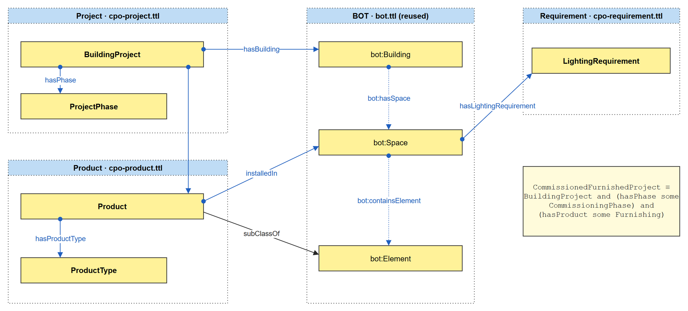

# Construction Project Typology Ontology (CPO)

An OWL ontology of building projects, their phases, the products installed in their buildings, and the requirements on their spaces. It is the worked example of the course TADS23 Advanced Building Information Delivery at Jönköping University.

*The composed ontology in Graffoo: yellow boxes are classes, blue arrows object properties, and dotted boxes modules. The spanning axioms `hasBuilding`, `installedIn` and `hasLightingRequirement` connect the modules with BOT.*

- Website: https://richzele.github.io/cpo/, with the modules, the merged ontology, their documentation and every file
- Ontology: https://w3id.org/cpo
- Documentation: https://richzele.github.io/cpo/doc/cpo/, made with [WIDOCO](https://github.com/dgarijo/Widoco), with a WebVOWL diagram of each ontology
- Namespace: `https://w3id.org/cpo#` (prefix `cpo:`)

| Ontology IRI | File | Documentation | Content |
|---|---|---|---|
| `https://w3id.org/cpo` | `cpo.ttl` | [doc/cpo](https://richzele.github.io/cpo/doc/cpo/) | The composed ontology: imports the modules and BOT, with the alignment and spanning axioms. Its documentation covers every term of CPO. |
| `https://w3id.org/cpo/project` | `cpo-project.ttl` | [doc/project](https://richzele.github.io/cpo/doc/project/) | Building projects, their types, phases and status |
| `https://w3id.org/cpo/product` | `cpo-product.ttl` | [doc/product](https://richzele.github.io/cpo/doc/product/) | Installed products, their types and quantities |
| `https://w3id.org/cpo/requirement` | `cpo-requirement.ttl` | [doc/requirement](https://richzele.github.io/cpo/doc/requirement/) | Lighting requirements for types of space |

Each ontology is also available as RDF/XML (`.owl`), JSON-LD (`.jsonld`) and N-Triples (`.nt`). The Turtle files are laid out for reading: one statement per line.

The merged ontology, `cpo-merged.ttl` (also `.owl`, `.jsonld` and `.nt`), holds the three modules and the composed ontology in one file, with BOT as its only import. It is handy for tools that do not follow imports.

The Graffoo diagram of each module is in `img/`.

To use it, open `https://w3id.org/cpo` in Protégé (File > Open from URL). The modules and BOT are imported from their own IRIs.

## For education

This repository is made for teaching. CPO is the worked example of the course TADS23 Advanced Building Information Delivery at Jönköping University. In the lectures, students build it step by step with ABID-Mo, the course's modular ontology modeling method:

| Lecture | What is built |
|---|---|
| 4a | The project module: building projects, their phases and status |
| 4b | The product module: installed products and their types from a manufacturer catalogue |
| 4c | The requirement module, and the composed ontology that imports the modules, aligns them with BOT and connects them with spanning axioms |

Students can compare their own ontology with the files here and reuse CPO in their projects. The ontology is kept small on purpose, so that each modeling decision can be explained in class; it is an example for learning, not a complete ontology for practice.

Maintainer: Rahel Kebede, rahel.kebede@ju.se

Licence: [CC BY 4.0](https://creativecommons.org/licenses/by/4.0/). See `LICENSE`.
